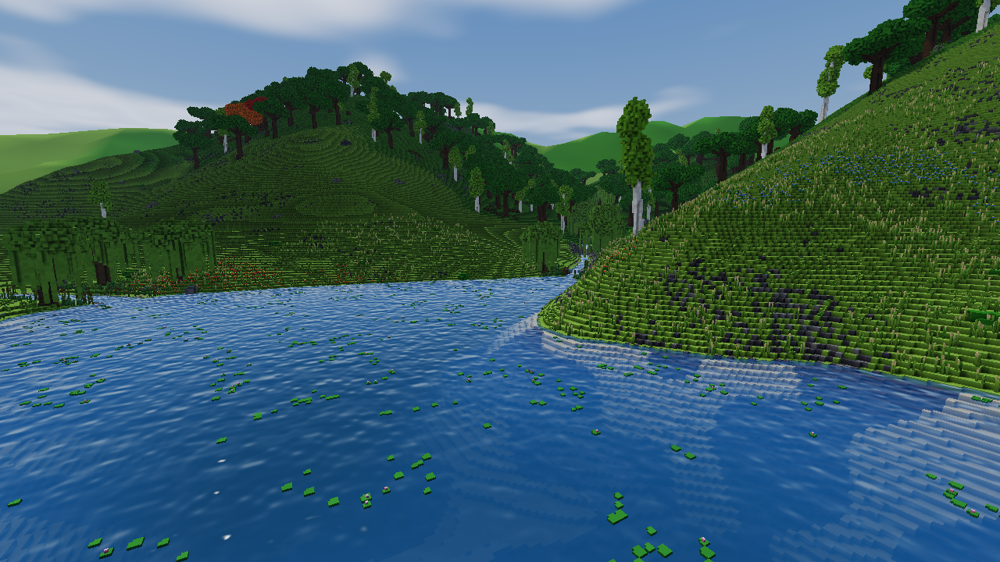
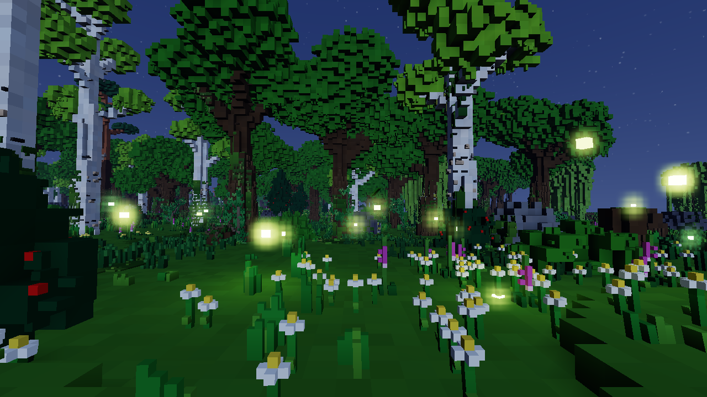

<p align="center"></p>

**Willow Hollow** is a peaceful first-person exploration game in Rust: an endless world of coloured cubes and light, built around real rivers. Springs gather into streams, streams cascade into rivers, rivers fill lakes and reach the sea — every drop flowing downhill because the land it crosses was shaped by erosion before you arrived.

No textures. Form comes from the shapes of things, sunlight and shadow, mist and water.


## What's here

**A world that is actually hydrological.** Each landmass is simulated as a whole: tectonic uplift worn down by stream-power erosion (the FastScape / Braun–Willett implicit scheme), run coarse-to-fine, with priority-flood drainage, valley widening around big rivers, dammed lakes, wind-driven rainfall with rain shadow, and Whittaker biomes from the resulting climate. A 1024×1024 continent takes about three seconds.

**Rivers in voxels.** The simulation grid is 32 voxels coarse, so rivers are not sampled from it. They are smooth meandering curves through the drainage network, carved into the terrain at voxel resolution, with water levels quantised into still pools and drops — long calm reaches with the odd weir in the lowlands, stepped cascades in the hills. Water is contained by construction: tests check thousands of water columns for leaks and find none.

**An endless archipelago.** The world is an infinite grid of 32 km cells, each holding a continent, an island group or open sea, generated lazily on a background thread as you approach. Land never crosses a cell border, which is what makes whole-watershed simulation possible.

**Far view.** Beyond the loaded voxels the continent itself is drawn to the horizon: biome-coloured slopes, forest cover, lakes, the sea, and rivers as ribbons winding into the haze.

**Light and weather.** Three-cascade shadow maps, a drifting cloud layer that shadows the ground, depth-tinted rippling water with sun glitter, ground mist in the valleys at dawn, bloom, moon and stars, and a day that turns in real time.

**Living detail.** Fourteen procedural tree species — oak, birch, maple, cherry, spruce, willow, acacia, baobab, palm, jungle trees, and towering redwood, kapok and elder-oak giants — placed by biome in groves and clearings, with willows along the banks and palms on warm beaches. Bushes, ferns, boulders, fallen logs, flower and heather drifts. A wandering wind that stirs the leaves and carries waterfall spray, falling leaves, pollen, butterflies, fireflies at dusk and the odd flock of birds.

**Trails and landmarks.** Every landmass is walked by a network of paths joining shrines, lookout towers you can climb, camps, ruins, standing stones, cairns on the passes, stone arches, huts and boat landings. Sites are read off the land (lookouts on hills, shrines at springs and lake shores, cairns on saddles) and built from local materials, so a desert shrine is sandstone and a redwood-forest one is mossy rock and red timber. Paths cross brooks on stepping stones, streams on log and plank bridges, and rivers on arched stone bridges, with lanterns that come on at dusk.

**Ways to travel.** Open a glider in mid-air and ride it down off a tower or a ridge. Each landing has a boat moored at it: sail the rivers, or set out across the strait for the next landmass.

| | |
|---|---|
|  |  |
|  |  |
|  |  |

The same world from above — the origin continent's biomes, and a neighbouring cell's islands running from ice caps to temperate forest:

| | |
|---|---|
|  |  |

## Running it

Rust stable (edition 2024) and, on Windows, the MSVC build tools. Nothing else to install: there are no assets.

```sh
cargo run --release -p game               # start on a river bank
cargo run --release -p game -- --fly      # free camera
cargo run --release -p game -- --help     # all options
```

| Key | |
|---|---|
| mouse | look (captured automatically; **Tab** toggles, **Esc** frees the cursor) |
| W A S D | move |
| Space | jump, swim up |
| Shift | sprint |
| G, or Space in mid-air | open or fold the glider; look down to dive, up to slow |
| E | board a boat at a landing, or go ashore (W sails, Shift for full sail) |
| F | toggle flying (Space / Ctrl up and down, wheel sets speed) |
| F3 | hide the debug panel |

Useful options: `--seed N` for a new world, `--time H` for the hour of day, `--day-minutes M` for how long a day lasts (0 freezes it), `--radius N` for the voxel load radius.

The first launch simulates the starting continent (about three seconds) before the window opens. Expect 100+ fps at 1080p on a GTX 1650 Ti class GPU.

### Looking at the world without playing

```sh
# Relief, biome and rainfall maps of a cell with its trails, plus coordinates of landmarks,
# crossings, falls, lakes, confluences and biomes
cargo run --release -p mapgen -- --seed 1 --poi

# A still from any viewpoint, rendered headless
cargo run --release -p game -- --screenshot shot.png --over 22262,18550,14 --look 45,-26 --time 11
```

## How it's put together

```
crates/worldgen   pure CPU: macro layout, continent simulation, climate, biomes,
                  the voxel-resolution surface (rivers, lakes, materials), features,
                  trails and landmarks
crates/voxel      chunk storage and the greedy mesher with baked ambient occlusion
crates/game       wgpu renderer, chunk streaming, far view, player, particles
tools/mapgen      renders a continent's simulation to PNG maps
```

A few decisions worth knowing about:

- **Chunks are self-contained.** Each 32³ chunk is generated with a one-voxel border, so meshing never waits on a neighbour and any chunk can be built in any order on any thread. Trees spanning several chunks are placed on fixed world-space grids, so every chunk stamps them identically.
- **The camera is the origin.** Positions are f64 on the CPU and camera-relative f32 on the GPU, so precision holds anywhere in the endless world.
- **Water never flows uphill.** The simulation stores a water level that is non-increasing along every flow path; river curves interpolate it; pooling is a monotone function of it. The property survives all the way to voxels, and tests assert it.
- **Collision regenerates rather than remembers.** A chunk column takes well under a millisecond to generate, so the few columns the player touches are rebuilt on demand instead of keeping voxel data for every meshed chunk.

Worldgen is deterministic from the seed and covered by tests: drainage reaches the sea, rivers only grow downstream, lakes are flat, chunk seams agree, water is contained, the spawn is on dry land beside a river.

## Influences

Cube World for the scale and feel; Veloren's erosion-based world generation; and a set of Minecraft mods whose methods shaped particular pieces — Geophilic and Blooming Biosphere (ground detail, flower drifts, biome palettes), Wilder Wild (wind, fallen trees), Particular and Subtle Effects (cascade spray, fireflies, falling leaves), RoadWeaver (the trail network).

## Roadmap

Tracked as issues. In short: ambient sound, more biomes and continent archetypes, settings and saved state, tree impostors in the far view, and a performance pass.

## Logo

`docs/images/logo.png` (and a transparent variant) are rendered by `docs/logo.py` with Pillow and the Georgia typeface; run `python docs/logo.py docs/images` to regenerate.

## Licence

Not yet decided; all rights reserved for now.
