<p align="center"></p>

Willow Hollow is a first-person game about wandering around a huge, quiet world made of coloured cubes. There's nothing to fight and nothing to build. You follow a river to see where it goes, climb a watchtower, jump off it with a glider, and borrow a boat when you run out of land. If you like, you can pick the wild flowers on the way.

There are no textures anywhere in it. Every cube is a flat colour, and the rest comes from shape, sunlight, mist and water.

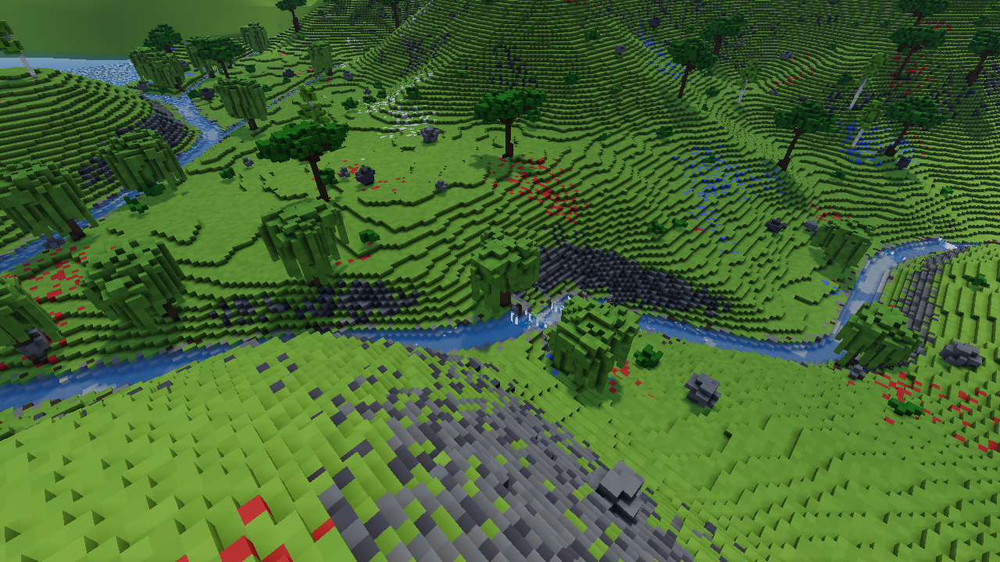

## The rivers

Rivers are the heart of this project. Each landmass is run through an erosion simulation before you ever see it, so the valleys are there because water cut them. A stream starts high in the hills, picks up tributaries on the way down, and ends in a lake or the sea. If you pick any trickle and follow it downhill, you will get somewhere.

The simulation is much coarser than the voxels, so rivers aren't read straight off its grid. They're smooth curves traced through the drainage network and carved into the ground afterwards, with the water stepping down in flat pools. Lowland rivers run long and calm. Hill streams come down in little waterfalls. Water never runs uphill and never leaks out of its bed, and the tests check both.

## What else is out there

**An endless ocean of islands.** The world is an infinite grid of cells about 26 km across. Each one holds a continent, a scatter of islands or open sea, and gets generated in the background as you head towards it.

**The land.** There are twenty-two kinds of country, from marsh and birch wood to dune sea, mangrove and black volcanic islands. On the open moor, granite tors stand on the summits with their fallen blocks strewn down the slope below. Hillsides break into cliffs that show the rock in layers, small caves run back into the slopes, narrow ravines cut through rocky ground, and streams start from springs. Every region, river, lake, peak and landmark has a name, and the names in one region sound as if they belong together.

**Forests.** There are nineteen kinds of tree, from birches and cherries through holly, yew and Scots pine up to redwoods big enough to feel silly standing next to. They grow in groves that suit the climate, with willows on the riverbanks and palms on warm beaches. Moss grows in the shade on trunks, logs and boulders, and ivy climbs trees and walls.

**Small things.** Grass, flowers, reeds, mushrooms and lily pads are little models built from blocks a quarter of a voxel wide. There are six kinds of grass, from short lawn to seed-headed meadow to the sedge along the rivers, and they grow in drifts that suit the climate. Fallen logs lie along the slope they landed on, and pushing through a bush slows you down. Keep an eye out for butterflies during the day and fireflies at dusk.

**Wild flowers.** There are twenty-seven kinds, each in the places it would really grow: bluebells carpeting the broadleaf woods, poppies and buttercups in the meadows, heather and foxgloves on the moor, kingcups and flag irises by the streams, thrift on the dunes, gentians high up. You can pick them, and mushrooms, berries, gorse blossom and reed mace too, and carry them in your pack. A flower you pick stays picked, and grows back a year or two later.

**Places to find.** Every landmass has a network of trails linking shrines, lookout towers, camps, ruins, standing stones, huts and boat landings. They're built from whatever is local, so a desert shrine is sandstone and a shrine among the redwoods is mossy rock and red timber. The paths are worn into the ground, climb steep slopes in rough steps, and are marked by cairns, waymarks and milestones. They cross brooks on stepping stones and rivers on arched stone bridges, and the lanterns come on at dusk.

**Getting around.** Open the glider in mid-air and ride it off anything tall. Every landing has a boat tied up, which you can take down a river or across the strait to the next island. Press V to see yourself from behind: a small figure that walks, swims and carries the glider folded on its back.

**The map.** The map fills in with what you've seen, which is further from high ground, and shows a faint line where you've walked. A small one sits in the corner, turned the way you face, with the name of the place or the region you're in along its foot. The large one is a model of the land you've seen, made of blocks like the world, which you can move, turn and zoom, from the whole continent down to a single clearing. Both are lit by an afternoon sun, so hills shade their valleys and trees throw shadows, and close in they show the world's own trees, huts, shrines, ruins, bridges, jetties and tors as small models of themselves, in the colours of the season. Regions, ranges, lakes, rivers and peaks are named on the large map once you've seen them; the things people built keep their names until you've been there.

**The sky and the year.** The day turns in real time, with mist in the valleys at dawn, and a moon and stars at night. The clouds are built of blocks too. They cast blocky shadows on the ground, and you can fly up through them and look down on them. Each day brings its own weather, from clear to overcast, with rain, snow, storms and fog, and rain splashes where it lands. The year turns as well: flowers come out in their season, the leaves colour and fall in autumn, and in winter snow lies on the high ground and in cold country, and now and then on the lowlands too. Past the edge of the loaded terrain, the continent carries on to the horizon in a simpler form, so you can see where a river is heading long before you reach it.

| | |
|---|---|
| 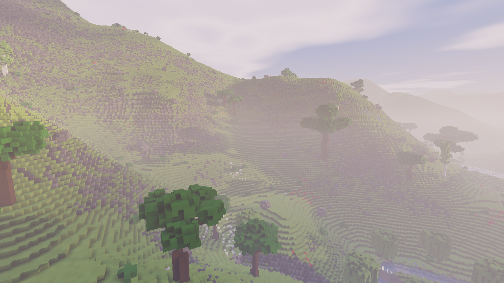 | 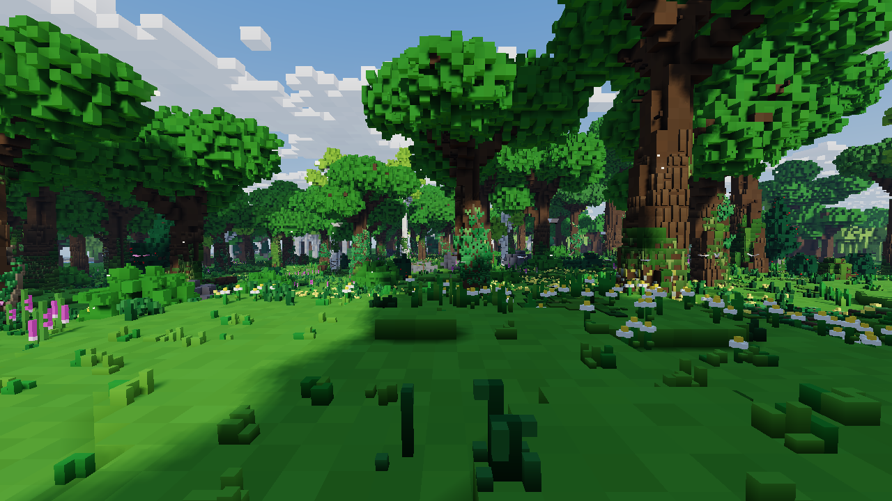 |
|  |  |
|  | 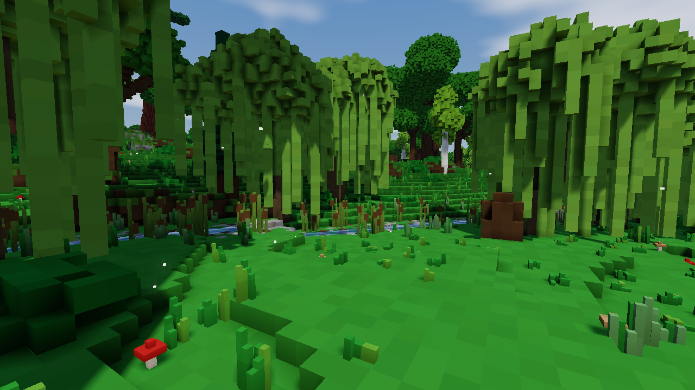 |
| 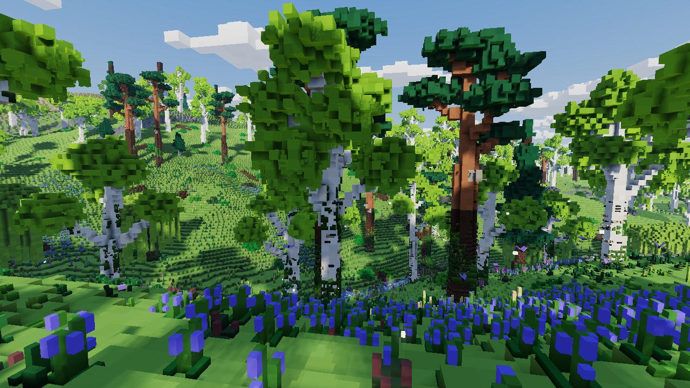 | 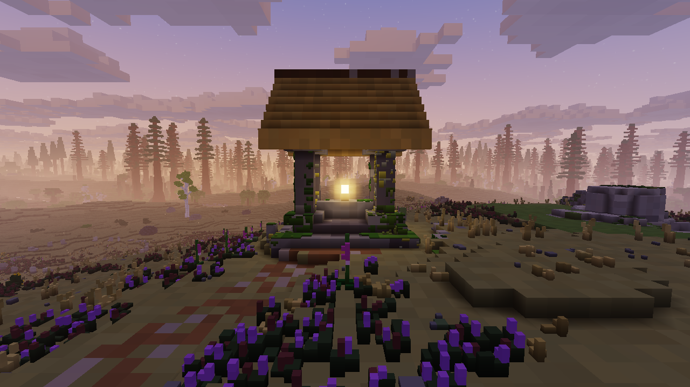 |
| 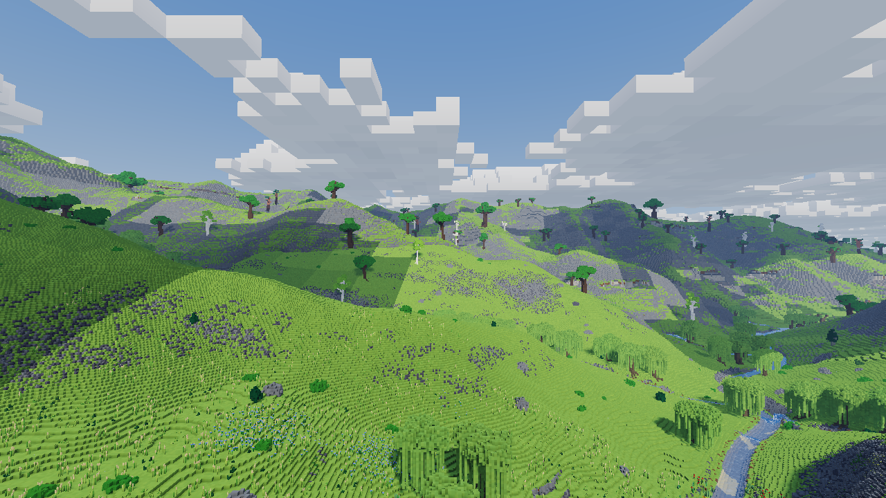 | 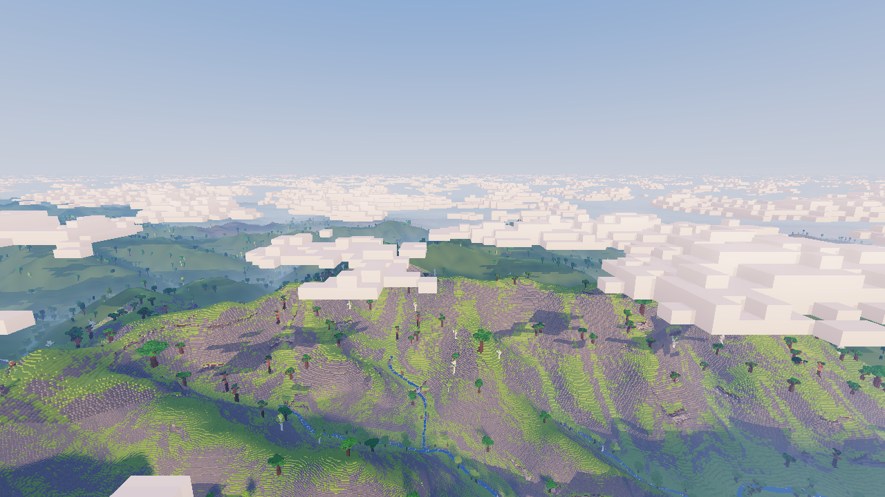 |
| 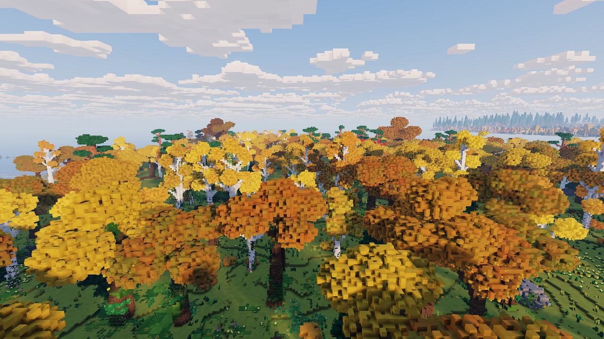 | 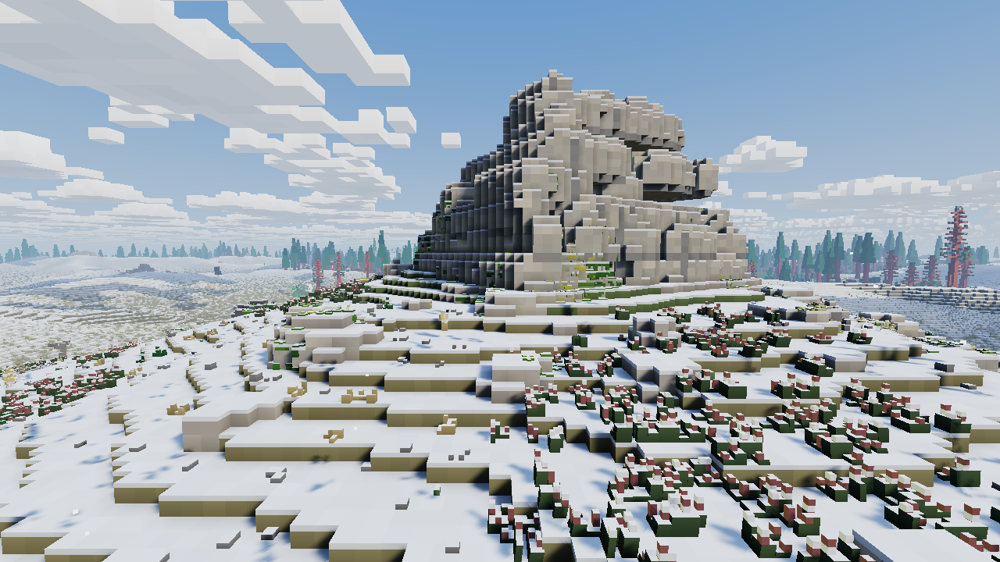 |
| 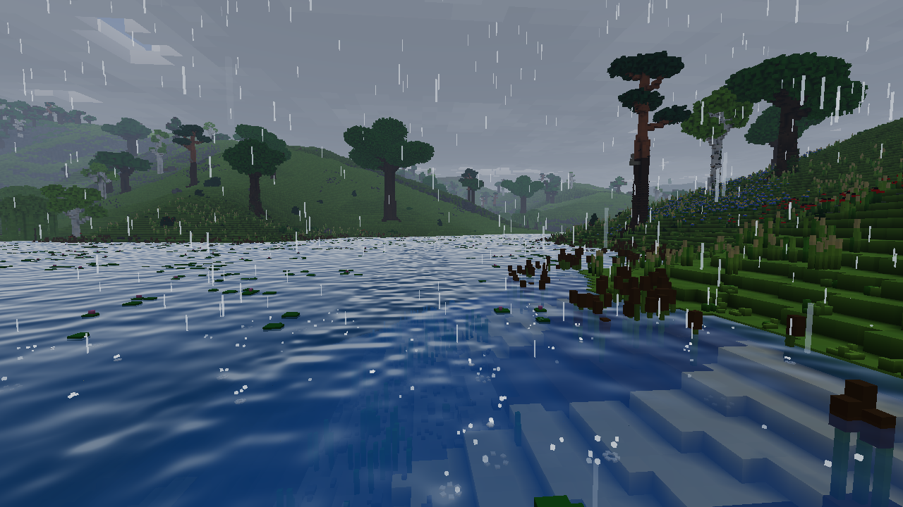 | 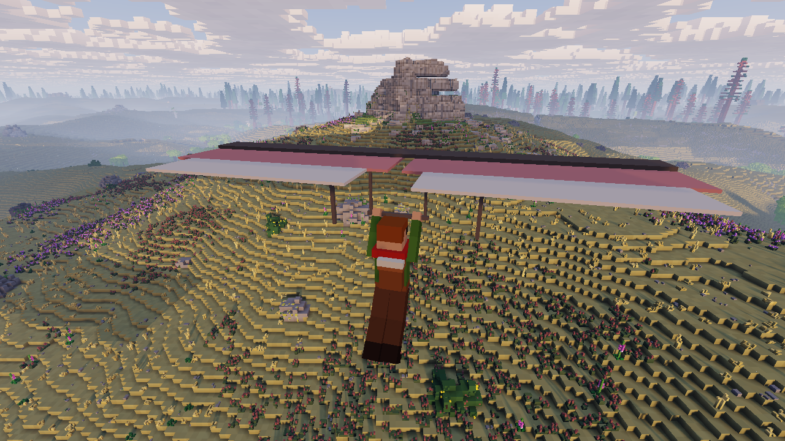 |
| 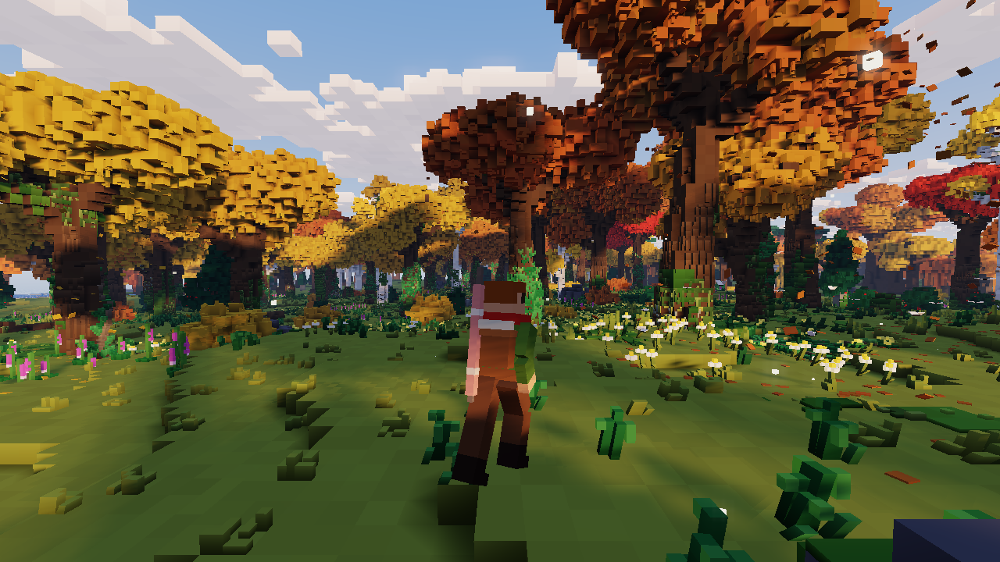 | 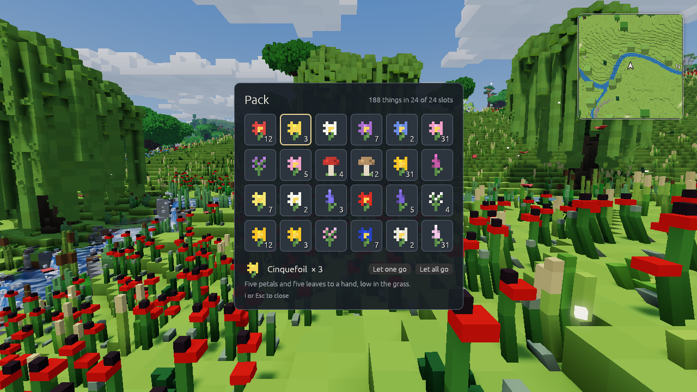 |

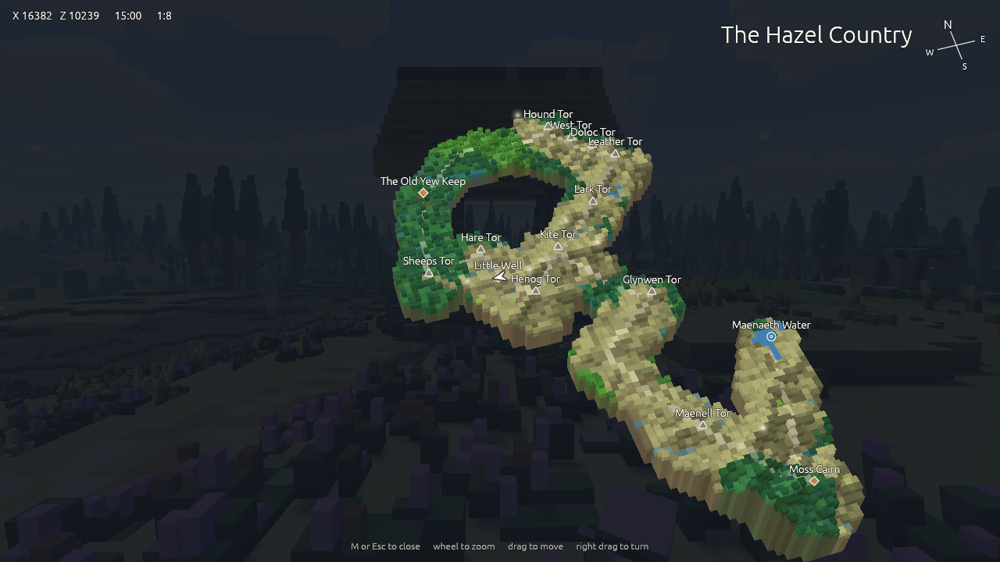

Here's the same world from above, as `mapgen` draws it: the biomes of the starting continent, and the islands in the cell next door.

| | |
|---|---|
| 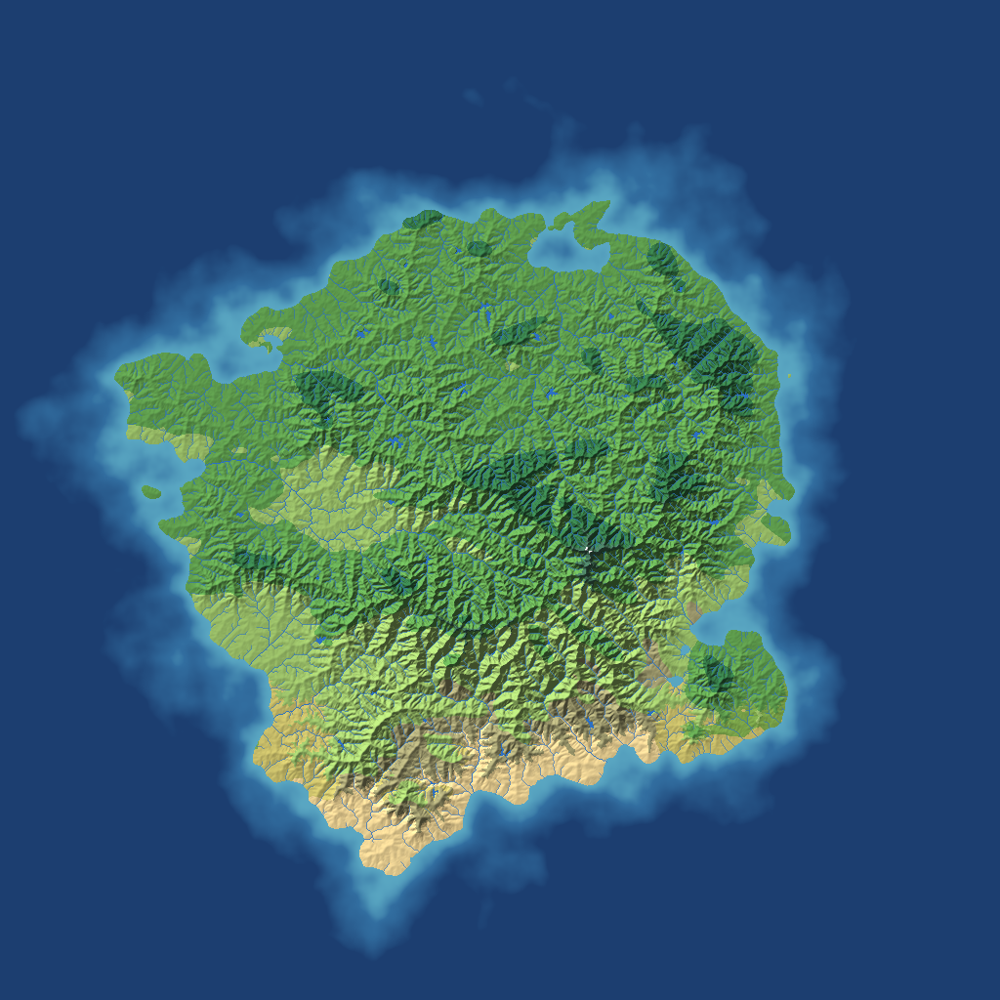 | 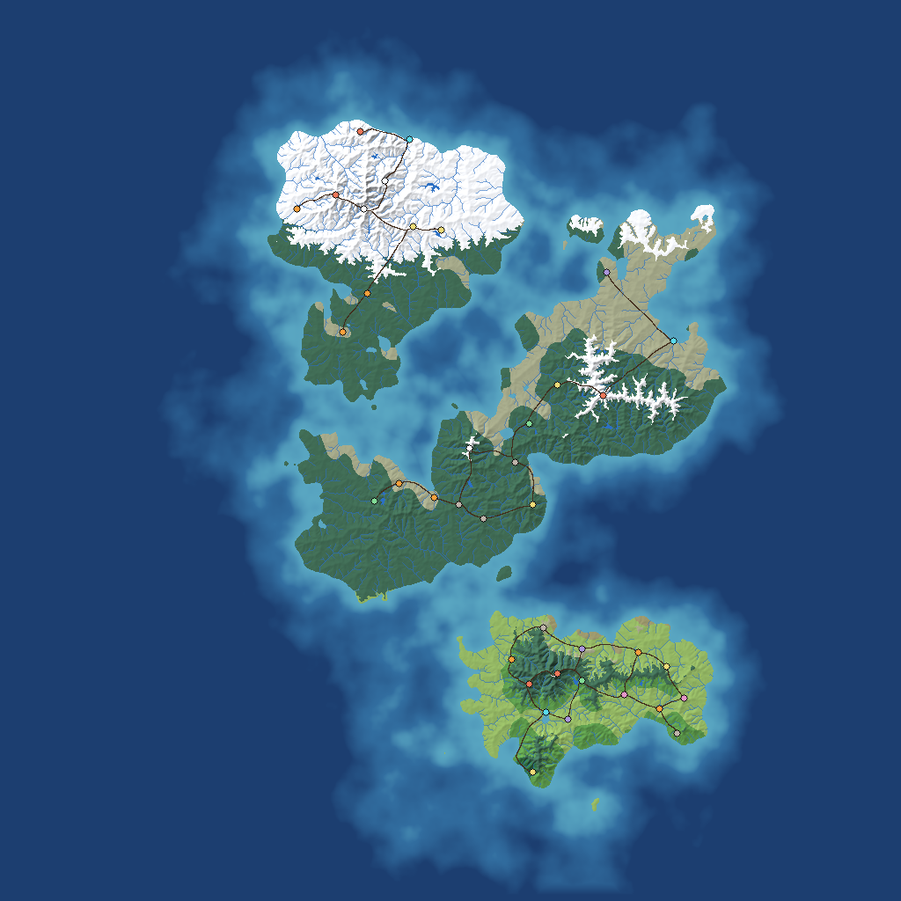 |

## Playing it

You need stable Rust (edition 2024), plus the MSVC build tools on Windows. There's nothing to download beyond that, because the game has no asset files. So far it has only been run on Windows. To work on the game rather than just play it, see [docs/DEVELOPMENT.md](docs/DEVELOPMENT.md).

```sh
cargo run --release -p game                  # a new world, starting on a river bank
cargo run --release -p game -- --seed 1      # world 1, from where you left off
cargo run --release -p game -- --fly         # free camera
cargo run --release -p game -- --help        # every option
```

The first launch takes a few seconds, because the starting continent has to be simulated before the window opens. On a laptop GTX 1650 Ti it runs at around 135 fps at 1080p.

| Key | What it does |
|---|---|
| Mouse | Look around (**Tab** frees or recaptures the mouse) |
| Esc | Settings, or close the map or the pack |
| W A S D | Walk |
| Shift | Sprint |
| Space | Jump, or swim up |
| G, or Space in mid-air | Open or fold the glider. Look down to dive, up to slow down |
| E | Pick what's in front of you, or get in or out of a boat at a landing. W sails, Shift for full sail |
| I | Open the pack. Drag one thing onto another to move, join or swap them, click one to read about it or let it go |
| M | The large map. Drag to move it, right drag to turn it, the wheel to zoom |
| N | Show or hide the corner map |
| V | First or third person |
| F | Toggle flying. Space and Ctrl go up and down, the wheel sets the speed |
| F3 | Hide the debug panel |
| F11 | Fullscreen |

The settings menu covers field of view, mouse sensitivity, volume, how far terrain loads, the length of a day and of a year, window size, fullscreen, vsync, light shafts and the corner map. If you push the load radius further than your graphics card can hold, the game pulls it back in by itself.

A plain run starts a new, random world each time. The game remembers your settings and where you were standing in each world, boat included, along with the time of year, the map you've drawn and what's in your pack, so `--seed N` takes you back to world N where you left it. Use `--fresh` to go back to the start of a world. `--time H` picks the hour and `--season` the time of year for one run, and the debug panel has sliders for both.

### Looking around without playing

`mapgen` draws relief, biome and rainfall maps of a cell and prints the coordinates of anything interesting. The game can also render a single frame without opening a window, which is handy for checking a change. `--weather` and `--date` set the sky and the season for the shot.

```sh
cargo run --release -p mapgen -- --seed 1 --poi
cargo run --release -p game -- --seed 1 --screenshot shot.png --over 31776,43030,30 --look 280,-6 --time 17.5 --weather clear
```

## How it's put together

```
crates/worldgen   continents, climate, biomes, rivers, trees, plants, trails, landmarks and names
crates/voxel      chunk storage and the mesher
crates/game       renderer, chunk streaming, player, weather and seasons, map, pack, sound
tools/mapgen      draws a continent's simulation as PNG maps
tools/bench       times chunk generation and checksums what it made
```

If you're curious about the details:

- The erosion is stream-power erosion using the FastScape implicit solver, with priority-flood drainage and rainfall that leaves rain shadows behind mountains. A 1024×1024 continent takes about three seconds.
- A voxel is 40 cm. Each 32³ chunk is generated with a one-voxel border, so chunks can be built on any thread in any order without waiting for their neighbours.
- Land never crosses the border of a world cell. That's what makes it possible to simulate a whole watershed at once and still have an endless world.
- All chunk meshes live in one big GPU buffer and go out as a multi-draw, with faces grouped by direction so the ones pointing away from you get skipped.
- Positions are 64-bit on the CPU and camera-relative on the GPU, so nothing gets jittery a long way from the start.
- Collision doesn't keep any voxel data around. A column without its small plants takes about a millisecond to generate, so the few under the player are just rebuilt when needed. Falling leaves and rain get theirs from a background thread, so they never hold up a frame.
- Moss, ivy, bark and twigs are most of the cost of a column, so they're only grown for columns close enough to show them. `cargo run --release -p bench` times all this and prints a checksum of everything generated, which is how a speed-up gets shown not to have changed the world.
- The whole world comes from the seed. The tests check that drainage reaches the sea, rivers only grow on the way down, lakes are flat, and chunk edges line up.

The logo is drawn by `docs/logo.py`, using Pillow and Georgia. Run `python docs/logo.py docs/images` to redraw it.

## Where the ideas came from

Cube World, for the scale and the feeling of it. Veloren, for showing that erosion-based world generation works. A handful of Minecraft mods also shaped particular pieces: Geophilic and Blooming Biosphere for ground detail and flower drifts, Wilder Wild for wind and fallen trees, Particular and Subtle Effects for waterfall spray, fireflies and falling leaves, and RoadWeaver for the trail network.

## Still to do

The issues tab has the full list. Footsteps are the only sound for now, and the ambience will come from real recordings later.

## Licence

Not decided yet, so all rights reserved for now.
