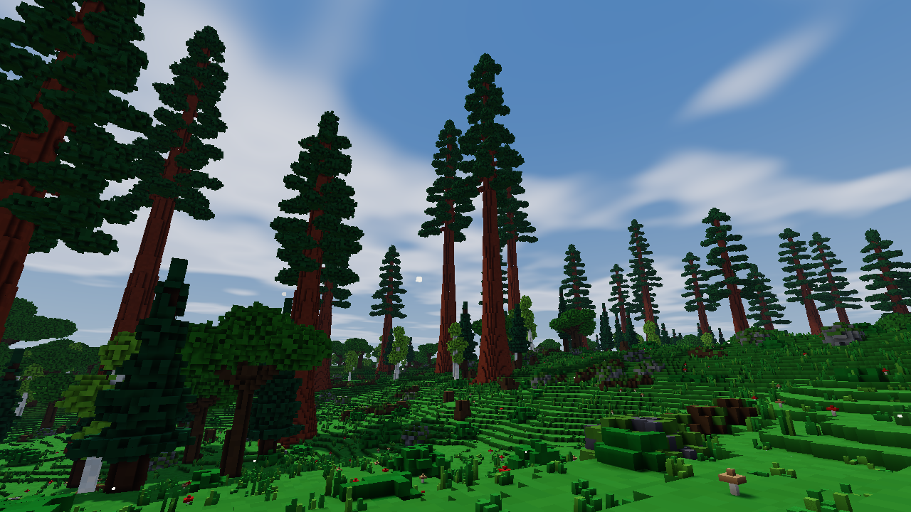

<p align="center"></p>

Willow Hollow is a first-person game about wandering around a huge, quiet world made of coloured cubes. There's nothing to fight and nothing to build. You follow a river to see where it goes, climb a watchtower, jump off it with a glider, and borrow a boat when you run out of land.

There are no textures anywhere in it. Every cube is a flat colour, and the rest comes from shape, sunlight, mist and water.


## The rivers

Rivers are the heart of this project. Each landmass is run through an erosion simulation before you ever see it, so the valleys are there because water cut them. A stream starts high in the hills, picks up tributaries on the way down, and ends in a lake or the sea. If you pick any trickle and follow it downhill, you will get somewhere.

The simulation is much coarser than the voxels, so rivers aren't read straight off its grid. They're smooth curves traced through the drainage network and carved into the ground afterwards, with the water stepping down in flat pools. Lowland rivers run long and calm. Hill streams come down in little waterfalls. Water never runs uphill and never leaks out of its bed, and the tests check both.

## What else is out there

**An endless ocean of islands.** The world is an infinite grid of cells about 26 km across. Each one holds a continent, a scatter of islands or open sea, and gets generated in the background as you head towards it.

**Forests.** There are fourteen kinds of tree, from birches and cherries up to redwoods big enough to feel silly standing next to. They grow in groves that suit the climate, with willows on the riverbanks and palms on warm beaches.

**Small things.** Grass, flowers, reeds, mushrooms and lily pads are little models built from blocks a quarter of a voxel wide. There are six kinds of grass, from short lawn to seed-headed meadow to the sedge along the rivers, and they grow in drifts that suit the climate. Fallen logs lie along the slope they landed on, and pushing through a bush slows you down. Keep an eye out for butterflies during the day and fireflies at dusk.

**Places to find.** Every landmass has a network of trails linking shrines, lookout towers, camps, ruins, standing stones, huts and boat landings. They're built from whatever is local, so a desert shrine is sandstone and a shrine among the redwoods is mossy rock and red timber. Paths cross brooks on stepping stones and rivers on arched stone bridges, and the lanterns come on at dusk.

**Getting around.** Open the glider in mid-air and ride it off anything tall. Every landing has a boat tied up, which you can take down a river or across the strait to the next island.

**The sky.** The day turns in real time, with drifting clouds that shadow the ground, mist in the valleys at dawn, and a moon and stars at night. Past the edge of the loaded terrain, the continent carries on to the horizon in a simpler form, so you can see where a river is heading long before you reach it.

| | |
|---|---|
|  |  |
|  |  |
|  |  |

Here's the same world from above: the biomes of the starting continent, and the islands in the cell next door.

| | |
|---|---|
|  |  |

## Playing it

You need stable Rust (edition 2024), plus the MSVC build tools on Windows. There's nothing to download beyond that, because the game has no asset files. So far it has only been run on Windows.

```sh
cargo run --release -p game               # start on a river bank
cargo run --release -p game -- --fly      # free camera
cargo run --release -p game -- --help     # every option
```

The first launch takes a few seconds, because the starting continent has to be simulated before the window opens. On a laptop GTX 1650 Ti it runs at around 135 fps at 1080p.

| Key | What it does |
|---|---|
| Mouse | Look around (**Tab** frees or recaptures the mouse) |
| Esc | Settings |
| W A S D | Walk |
| Shift | Sprint |
| Space | Jump, or swim up |
| G, or Space in mid-air | Open or fold the glider. Look down to dive, up to slow down |
| E | Get in or out of a boat at a landing. W sails, Shift for full sail |
| F | Toggle flying. Space and Ctrl go up and down, the wheel sets the speed |
| F3 | Hide the debug panel |
| F11 | Fullscreen |

The settings menu covers field of view, mouse sensitivity, volume, how far terrain loads, the length of a day, window size, fullscreen and vsync. If you push the load radius further than your graphics card can hold, the game pulls it back in by itself.

The game remembers your settings, the world you were in, and where you were standing in each world, boat included. Use `--fresh` to go back to the start of a world, or `--seed N` to try a different one. `--time H` picks the hour for one run, and the debug panel has a slider for it too.

### Looking around without playing

`mapgen` draws relief, biome and rainfall maps of a cell and prints the coordinates of anything interesting. The game can also render a single frame without opening a window, which is handy for checking a change.

```sh
cargo run --release -p mapgen -- --seed 1 --poi
cargo run --release -p game -- --screenshot shot.png --over 36890,35680,14 --look 0,-6 --time 15
```

## How it's put together

```
crates/worldgen   continents, climate, biomes, rivers, trees, trails and landmarks
crates/voxel      chunk storage and the mesher
crates/game       renderer, chunk streaming, player, sound
tools/mapgen      draws a continent's simulation as PNG maps
```

If you're curious about the details:

- The erosion is stream-power erosion using the FastScape implicit solver, with priority-flood drainage and rainfall that leaves rain shadows behind mountains. A 1024×1024 continent takes about three seconds.
- A voxel is 40 cm. Each 32³ chunk is generated with a one-voxel border, so chunks can be built on any thread in any order without waiting for their neighbours.
- Land never crosses the border of a world cell. That's what makes it possible to simulate a whole watershed at once and still have an endless world.
- All chunk meshes live in one big GPU buffer and go out as a multi-draw, with faces grouped by direction so the ones pointing away from you get skipped.
- Positions are 64-bit on the CPU and camera-relative on the GPU, so nothing gets jittery a long way from the start.
- Collision doesn't keep any voxel data around. A column takes about a millisecond to generate, so the few under the player are just rebuilt when needed.
- The whole world comes from the seed. The tests check that drainage reaches the sea, rivers only grow on the way down, lakes are flat, and chunk edges line up.

The logo is drawn by `docs/logo.py`, using Pillow and Georgia. Run `python docs/logo.py docs/images` to redraw it.

## Where the ideas came from

Cube World, for the scale and the feeling of it. Veloren, for showing that erosion-based world generation works. A handful of Minecraft mods also shaped particular pieces: Geophilic and Blooming Biosphere for ground detail and flower drifts, Wilder Wild for wind and fallen trees, Particular and Subtle Effects for waterfall spray, fireflies and falling leaves, and RoadWeaver for the trail network.

## Still to do

The issues tab has the full list. Near the top are moss, finer detail on trees, and more biomes. Footsteps are the only sound for now, and the ambience will come from real recordings later.

## Licence

Not decided yet, so all rights reserved for now.
